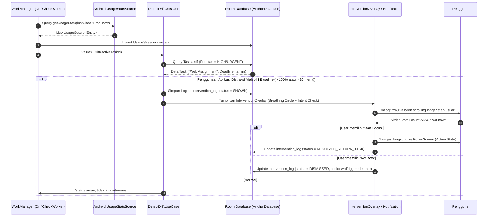
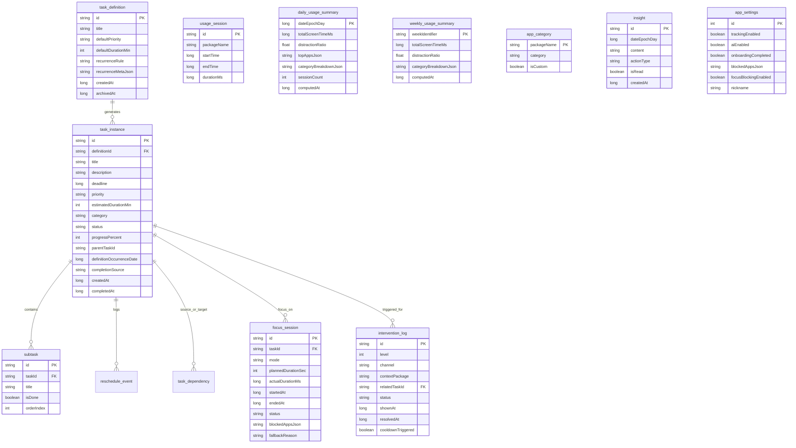

# Technical Design Document (Tech Spec): Nemo Personal Focus Assistant

---

## 1. Meta Information (Informasi Dokumen)

- **Judul Sistem:** Nemo — Personal Focus Assistant (Android Native)
- **Paket Aplikasi:** `com.anchor.app`
- **Penulis:** Core Android Engineering Team
- **Reviewer:** Lead Mobile Architect, Product Manager, Security & QA Lead
- **Status:** Approved
- **Tanggal Pembuatan:** 2026-10-10
- **Pembaruan Terakhir:** 2026-10-27
- **Target Platform:** Android 8.0+ (API Level 26 s.d. API Level 35)
- **Database Engine:** AndroidX Room SQLite (Schema Version 13)
- **Sumber Desain Kanvas:** `docs/superpowers/design/gamabaran.pen` (Design System Kit NEMO v1.0)
- **Dokumen Terkait:** `docs/superpowers/specs/2026-10-10-nemo-design-migration-design.md`, `justmd/fitur-aplikasi-nemo-maskot.md`

---

## 2. Overview (Ringkasan Eksekutif)

**Nemo** adalah aplikasi Android asisten fokus personal (*context-aware focus & task assistant*) yang menjembatani kesenjangan antara apa yang direncanakan pengguna (*Smart Todo*) dan apa yang secara aktual dilakukan pada perangkat smartphone (*Digital Wellbeing & App Usage*). Berbeda dengan aplikasi pemblokir konvensional yang bersifat memaksa atau menghukum, Nemo menerapkan pendekatan psikologis berlandaskan kesadaran (*awareness over control*), friksi lembut (*contextual soft friction*), dan visualisasi konsekuensi waktu (*Future View & Domino Effect*).

Sistem dirancang dengan arsitektur **Local-First & Privacy-First**. Seluruh data operasional, riwayat pemakaian aplikasi mentah (*raw app usage*), rekaman sesi fokus, konfigurasi aplikasi, dan daftar tugas disimpan 100% secara lokal menggunakan Room Database tanpa server terpusat. Fitur inferensi kecerdasan buatan (*AI Daily Reflection*) dijalankan dengan pendekatan hibrida: komputasi heuristik lokal deterministik secara offline dengan opsi integrasi aman Google Gemini API yang hanya menerima data ringkasan agregat tanpa membawa informasi pribadi (*zero PII transmission*). Seluruh antarmuka mengadopsi bahasa desain monokrom datar (*Nemo Day/Night Theme*) dengan tipografi *Fraunces* (display) + *Manrope* (body) serta maskot tinta hitam 12 ekspresi emosional yang diadaptasi langsung dari berkas desain kanvas `gamabaran.pen`.

---

## 3. Context & Background (Konteks & Latar Belakang)

### Masalah Pengguna & Teknis
1. **Intention-Action Gap:** Pengguna membuat daftar tugas harian (*todo list*), namun sering kali terdistraksi oleh *infinite scrolling* aplikasi hiburan (media sosial, video pendek) tanpa menyadari waktu yang terbuang.
2. **Kelemahan Pemblokir Tradisional:** Aplikasi pemblokir aplikasi (*app blocker*) ekstrem yang melempar paksa pengguna ke *home screen* cenderung memicu resistensi psikologis (*reactance theory*) sehingga aplikasi di-*uninstall* atau izin aksesibilitasnya dimatikan pengguna dalam 3–7 hari.
3. **Kekhawatiran Privasi Data Penggunaan HP:** Aplikasi pemantau aktivitas digital umumnya mengirim riwayat pemakaian aplikasi, durasi, dan waktu aktif pengguna ke server cloud pihak ketiga, meningkatkan risiko kebocoran data sensitif (*personally identifiable behavioral footprint*).
4. **Disiplin Resource Perangkat Bergerak:** Pemantauan aktivitas latar belakang (*background monitoring*) sering memboroskan baterai perangkat (*battery drain*) dan terbunuh oleh sistem operasi Android melalui agresivitas OEM Background Optimization (Doze Mode, App Standby Buckets).

### Dampak Solusi
Nemo menghadirkan intervensi berbasis kesadaran diri (*mindful awareness*), memberikan umpan balik tepat waktu ketika pengguna melenceng (*drift detection*), memproyeksikan efek domino keterlambatan tugas ke jadwal berikutnya, menyajikan jendela overlay pemblokiran tenang (*BlockOverlayWindow*) tanpa melempar paksa ke Home, serta menjamin data pribadi tetap berada di dalam storage lokal perangkat dengan konsumsi RAM di bawah 150 MB.

---

## 4. Goals & Non-Goals (Tujuan & Batasan Scope)

### Goals
1. **Local-First Reliability:** Menjalankan 100% fungsionalitas manajemen tugas, intervensi, sesi fokus, dan analisis wellbeing secara luring (*offline*) tanpa ketergantungan koneksi internet.
2. **Deterministic Drift Detection:** Mampu mendeteksi anomali pemakaian aplikasi non-produktif melampaui batas ambang (*drift threshold*) dalam interval pengecekan latar belakang 15 menit menggunakan Android `UsageStatsManager` dan `WorkManager`.
3. **Contextual Gentle Intervention:** Menyajikan intervensi layar transisi dengan latihan pernapasan (*breathing ring animation*) dan konfirmasi intensi sadar sebelum pengguna membuka aplikasi distraksi.
4. **Timeline Projection (Future View & Domino Effect):** Mengkalkulasi skenario perbandingan *Start Now* vs *Delay* serta menghitung dampak keterlambatan satu tugas terhadap tugas berikutnya (*cascading dependencies*).
5. **Strict Focus Mode with Aware App Blocking:** Memfasilitasi pemblokiran aplikasi adaptif (*Gentle*, *Strict*, *Custom*) berbasis `AnchorAccessibilityService` yang menampilkan `BlockOverlayWindow` dengan opsi *emergency unblock exit*.
6. **Strict Resource Budget:**
   - Alokasi RAM operasional: $\le 150\text{ MB}$.
   - Waktu peluncuran awal (*Cold Startup Time*): $\le 800\text{ ms}$.
   - Konsumsi baterai harian: $\le 3\%$ per siklus pengisian 24 jam.

### Non-Goals
1. **Tidak Membangun Backend Server Pribadi:** Nemo tidak memiliki layanan otentikasi akun (Google Sign-In, Email/Password), sync database cloud (Firebase/Supabase), atau multi-device real-time sync pada rilis ini.
2. **Tidak Mengirimkan Data Telemetri Mentah:** Tidak mengumpulkan rekaman nama aplikasi mentah, URL, ketukan keyboard, atau isi percakapan ke cloud mana pun.
3. **Bukan Parental Control / MDM:** Sistem bukan alat pengawasan anak atau *Mobile Device Management* korporat; pengguna adalah pemilik penuh perangkat yang dapat mematikan fitur kapan saja (*Autonomy > Forced Behavior*).
4. **Bukan Pengganti Kalender Kompleks:** Tidak mendukung integrasi protokol CalDAV / Microsoft Exchange / Google Calendar dua arah di fase awal.

---

## 5. Proposed Solution (Solusi yang Diajukan & Arsitektur)

Sistem mengadopsi prinsip **Clean Architecture** berlapis yang dipadukan dengan pola **Unidirectional Data Flow (UDF)** di lapisan presentasi Jetpack Compose.

### 5.1 Diagram Arsitektur Sistem (Mermaid)

```mermaid
graph TD
    subgraph UI_Layer [Presentation Layer - Jetpack Compose & MVI]
        UI_Screens[Compose Screens\nTasks | Wellbeing | Focus | Insights | TaskDetail | FutureView | Settings]
        UI_Overlays[In-App Overlays\nInterventionOverlay | BlockOverlayWindow]
        UI_Components[Nemo Design System\nNemoTheme | NemoColors | NemoButtons | TimerRing | NemoTaskRow]
        ViewModels[MVI ViewModels\nTasksViewModel | WellbeingViewModel | FocusViewModel | InsightsViewModel]
    end

    subgraph Domain_Layer [Domain Layer - Pure Kotlin Use Cases]
        TaskUseCases[Task UseCases\nGetTasks | AddTask | RescheduleTask]
        DriftDetector[DetectDriftUseCase]
        UsageUseCases[CollectUsageUseCase | AggregateUsageUseCase | PruneUsageUseCase]
        FutureViewCalc[FutureViewCalculator | ComputeDominoEffectUseCase]
        FocusUseCases[StartFocusUseCase | PauseFocusUseCase | FinishFocusUseCase]
        BlockingStrategy[AccessibilityBlockingStrategy]
    end

    subgraph Data_Layer [Data & Persistence Layer - Room DB Schema v13]
        RoomDB[(AnchorDatabase\nRoom SQLite v13)]
        TaskDao[TaskDao & SubtaskDao]
        UsageDao[UsageSessionDao & DailyUsageSummaryDao]
        FocusDao[FocusSessionDao]
        InterventionDao[InterventionLogDao]
        SettingsDao[AppSettingsDao\nSingle Source of Config & Flags]
        InsightDao[InsightDao]
    end

    subgraph Platform_Layer [Android Platform Integrations]
        WorkMgr[WorkManager Scheduler\nUsageCollectWorker | DriftCheckWorker | InterventionCheckWorker | PruningWorker]
        UsageStats[Android UsageStatsSource\nUsageStatsManager API]
        Accessibility[AnchorAccessibilityService\nWindow State Monitoring & BlockOverlayWindow]
        FocusSvc[FocusService\nForeground Service with Sticky Notification]
    end

    subgraph External_AI [Optional Opt-In Cloud Layer]
        GeminiSource[GeminiInsightSource\nHTTP Fail-Soft Client]
    end

    UI_Screens --> ViewModels
    UI_Overlays --> ViewModels
    UI_Components --> UI_Screens
    ViewModels --> Domain_Layer
    Domain_Layer --> Data_Layer
    
    Platform_Layer --> Data_Layer
    Platform_Layer --> Domain_Layer
    Domain_Layer --> Platform_Layer
    Domain_Layer -.-> |Opt-in & Sanitized| GeminiSource
```

### 5.2 Alur Sistem (System Workflows)

#### A. Alur Deteksi Drift dan Intervensi Kontekstual



#### B. Alur Sesi Fokus (Strict Mode Aware App Blocking)

```mermaid
sequenceDiagram
    autonumber
    participant User as Pengguna
    participant FocusUI as FocusScreen
    participant FC as StartFocusUseCase
    participant FS as FocusService (Foreground Service)
    participant AS as AnchorAccessibilityService
    participant TargetApp as Aplikasi Terdistraksi (e.g. TikTok)

    User->>FocusUI: Pilih Task, Mode (STRICT), Durasi (25m) -> Begin Focus
    FocusUI->>FC: invoke(taskId, STRICT, 25m)
    FC->>FS: Start Foreground Service (Persistent Notification)
    FC->>AS: Update Blocked Packages List ("com.zhiliaoapp.musically", etc.)
    User->>TargetApp: Buka aplikasi terlarang di latar belakang
    AS->>AS: onAccessibilityEvent (TYPE_WINDOW_STATE_CHANGED)
    AS->>AS: Cocokkan package name dengan Block List
    alt Terdeteksi Aplikasi Masuk Block List
        AS->>User: Tampilkan BlockOverlayWindow (Mindful Banner & Return to Task)
        Note over AS,User: Tidak melempar paksa ke HOME; menyadarkan dengan tenang
        User->>AS: Klik "Kembali ke Sesi Fokus" ATAU "Buka Darurat"
        alt User kembali ke tugas
            AS->>FocusUI: Buka aplikasi Nemo
        else Buka darurat
            AS->>FS: Catat fallbackReason = "EMERGENCY_UNBLOCK"
            AS->>AS: Sembunyikan BlockOverlayWindow sementara
        end
    else Aplikasi Diizinkan
        AS->>TargetApp: Izinkan akses tanpa hambatan
    end
    User->>FocusUI: Selesaikan Sesi (FinishFocusUseCase)
    FocusUI->>AS: Clear Block List
    FocusUI->>FS: Stop Foreground Service
```

---

## 6. API / Interface Design (Desain Antarmuka Sistem)

Karena Nemo adalah aplikasi Android native *local-first*, antarmuka primer terdiri atas:
1. **Contract Internal Use Case & Service Boundary** (Kotlin API)
2. **External Integration Contract** (Google Gemini REST API untuk AI Daily Reflection)

### 6.1 Kontrak Internal Use Cases (Kotlin Interface)

#### Focus Domain Use Cases
```kotlin
package com.anchor.app.core.domain.usecase.focus

import com.anchor.app.core.data.entity.FocusSessionEntity

data class StartFocusParams(
    val taskId: String?,
    val mode: String, // "GENTLE", "STRICT", "CUSTOM"
    val plannedDurationSec: Int?,
    val blockedApps: Set<String>
)

interface StartFocusUseCase {
    suspend operator fun invoke(params: StartFocusParams): Result<FocusSessionEntity>
}

interface PauseFocusUseCase {
    suspend operator fun invoke(sessionId: String): Result<Unit>
}

interface FinishFocusUseCase {
    suspend operator fun invoke(
        sessionId: String, 
        completed: Boolean, 
        fallbackReason: String? = null
    ): Result<FocusSessionEntity>
}
```

### 6.2 External API Integration: Google Gemini AI (Aggregated Reflection)

- **Failover Endpoints (diuji berurutan):**
  1. `POST https://generativelanguage.googleapis.com/v1beta/models/gemini-flash-lite-latest:generateContent`
  2. `POST https://generativelanguage.googleapis.com/v1beta/models/gemini-flash-latest:generateContent`
- **Autentikasi:** Parameter query URL `?key={BuildConfig.GEMINI_API_KEY}` atau Header `x-goog-api-key`. Jika key kosong di `BuildConfig`, klien langsung melakukan *short-circuit* ke generator aturan lokal luring (*NoOp / Rule-based engine*).
- **Format Transmisi:** Menggunakan client native `HttpURLConnection` dengan JSON parser `org.json`.

#### Payload Permintaan (Request Payload)
Data dikirim dalam format anonim teragregasi tanpa menyertakan metadata perangkat, nama aplikasi mentah, atau identitas pengguna:

```json
{
  "contents": [
    {
      "parts": [
        {
          "text": "You are Nemo, a supportive and calm focus assistant. Analyze this aggregated daily summary and return JSON with keys: summary (string), patterns (array of strings), risk_level (\"low\"|\"medium\"|\"high\"), suggestions (array of strings), recommended_action (\"start_focus\"|null). Data:\nTotal screen time: 318 minutes\nDistraction ratio: 34%\nCompleted tasks: 2 of 3\nFocus session time: 102 minutes."
        }
      ]
    }
  ],
  "generationConfig": {
    "temperature": 0.4,
    "maxOutputTokens": 300,
    "responseMimeType": "application/json"
  }
}
```

#### Respon Berhasil (200 OK)
```json
{
  "candidates": [
    {
      "content": {
        "parts": [
          {
            "text": "{\n  \"summary\": \"You completed difficult tasks earlier than usual today.\",\n  \"patterns\": [\"Peak focus between 09:00 - 11:00\", \"Distraction spike after 14:00\"],\n  \"risk_level\": \"medium\",\n  \"suggestions\": [\"Tomorrow, start your hardest task within your first productive window.\"],\n  \"recommended_action\": \"start_focus\"\n}"
          }
        ]
      },
      "finishReason": "STOP"
    }
  ]
}
```

#### Kebijakan Fail-Soft Handling
Jika terjadi kendala koneksi (`IOException`), response HTTP non-200, atau timeout:
- Fungsi `generateInsight()` di `GeminiInsightSource.kt` mengembalikan `null` (*fail-soft*).
- Sistem otomatis mengaktifkan *rule-based insight generator* luring yang membaca data dari `daily_usage_summary` dan `task_instance` secara 100% lokal tanpa menampilkan error dialog yang mengganggu pengguna.

---

## 7. Data Model & Storage (Skema Database Room v13)

Penyimpanan persisten menggunakan **Room Database (SQLite)**. Database bersifat single-user, ACID-compliant, dan terenkripsi bila dipadukan dengan SQLCipher.

### 7.1 Entity Relationship Diagram (ERD - Mermaid)



### 7.2 Spesifikasi Detail Tabel Database (Schema v13)

#### 1. Tabel `task_instance` (Tugas Konkret)
| Nama Kolom | Tipe Data SQLite | Nullable | Keterangan |
|---|---|---|---|
| `id` | `TEXT` | NOT NULL | UUID Primary Key |
| `definitionId` | `TEXT` | NULL | Foreign Key ke `task_definition(id)` (ON DELETE SET NULL) |
| `title` | `TEXT` | NOT NULL | Nama/judul tugas |
| `description` | `TEXT` | NULL | Catatan deskripsi detail |
| `deadline` | `INTEGER` | NULL | Timestamp epoch milidetik |
| `priority` | `TEXT` | NOT NULL | Enum: `LOW`, `MEDIUM`, `HIGH`, `URGENT` |
| `estimatedDurationMin` | `INTEGER` | NULL | Estimasi pengerjaan dalam menit |
| `category` | `TEXT` | NULL | Label kelompok tugas |
| `status` | `TEXT` | NOT NULL | Enum: `TODO`, `IN_PROGRESS`, `DONE`, `ARCHIVED` |
| `progressPercent` | `INTEGER` | NOT NULL | 0–100% dihitung dari subtask yang selesai |
| `parentTaskId` | `TEXT` | NULL | Hierarki relasi dependensi tugas dasar |
| `definitionOccurrenceDate`| `INTEGER`| NULL | Epoch timestamp tanggal keberulangan tugas |
| `completionSource` | `TEXT` | NULL | Sumber penyelesaian (`MANUAL`, `FOCUS_SESSION`) |
| `createdAt` | `INTEGER` | NOT NULL | Timestamp pembuatan record |
| `completedAt` | `INTEGER` | NULL | Timestamp penyelesaian tugas |

*Indeks Komposit Unik (Schema v13):*  
`CREATE UNIQUE INDEX idx_task_instance_def_date ON task_instance(definitionId, definitionOccurrenceDate);`  
*Indeks:* `CREATE INDEX idx_task_instance_status ON task_instance(status);`  
*Indeks:* `CREATE INDEX idx_task_instance_deadline ON task_instance(deadline);`

#### 2. Tabel `subtask` (Langkah Pengerjaan Tugas)
| Nama Kolom | Tipe Data SQLite | Nullable | Keterangan |
|---|---|---|---|
| `id` | `TEXT` | NOT NULL | UUID Primary Key |
| `taskId` | `TEXT` | NOT NULL | Foreign Key ke `task_instance(id)` (ON DELETE CASCADE) |
| `title` | `TEXT` | NOT NULL | Teks judul subtask |
| `isDone` | `INTEGER` | NOT NULL | `0` (Belum) atau `1` (Selesai) |
| `orderIndex` | `INTEGER` | NOT NULL | Urutan visual penyajian |

#### 3. Tabel `focus_session` (Rekaman Sesi Fokus)
| Nama Kolom | Tipe Data SQLite | Nullable | Keterangan |
|---|---|---|---|
| `id` | `TEXT` | NOT NULL | UUID Primary Key |
| `taskId` | `TEXT` | NULL | Foreign Key ke `task_instance(id)` |
| `mode` | `TEXT` | NOT NULL | `GENTLE`, `STRICT`, `CUSTOM` |
| `plannedDurationSec` | `INTEGER` | NULL | Target durasi sesi dalam satuan detik (Schema v11) |
| `actualDurationMs` | `INTEGER` | NOT NULL | Durasi aktual dalam milidetik |
| `startedAt` | `INTEGER` | NOT NULL | Timestamp mulai |
| `endedAt` | `INTEGER` | NULL | Timestamp berakhir |
| `status` | `TEXT` | NOT NULL | `ACTIVE`, `PAUSED`, `COMPLETED`, `ABANDONED` |
| `blockedAppsJson` | `TEXT` | NULL | Serialized list package name yang diblokir |
| `fallbackReason` | `TEXT` | NULL | Alasan keluar darurat / degradasi |

#### 4. Tabel `usage_session` (Rekaman Pemakaian Aplikasi Mentah)
| Nama Kolom | Tipe Data SQLite | Nullable | Keterangan |
|---|---|---|---|
| `id` | `TEXT` | NOT NULL | UUID Primary Key |
| `packageName` | `TEXT` | NOT NULL | Identifier package aplikasi (e.g. `com.tiktok.android`) |
| `startTime` | `INTEGER` | NOT NULL | Epoch millis waktu mulai sesi |
| `endTime` | `INTEGER` | NOT NULL | Epoch millis waktu akhir sesi |
| `durationMs` | `INTEGER` | NOT NULL | Durasi sesi foreground dalam milidetik |

*Kebijakan Retensi:* Data pada tabel ini otomatis di-prune (dihapus) setelah melewati 14–30 hari oleh `PruningWorker`.

#### 5. Tabel `daily_usage_summary` (Agregat Harian Permanen)
| Nama Kolom | Tipe Data SQLite | Nullable | Keterangan |
|---|---|---|---|
| `dateEpochDay` | `INTEGER` | NOT NULL | Primary Key (Epoch Day: `System.currentTimeMillis() / 86400000`) |
| `totalScreenTimeMs` | `INTEGER` | NOT NULL | Total durasi layar menyala dalam milidetik |
| `distractionRatio` | `REAL` | NOT NULL | Rasio pemakaian distraksi (0.0 s.d. 1.0) |
| `topAppsJson` | `TEXT` | NOT NULL | JSON string 5 aplikasi terlama |
| `categoryBreakdownJson`| `TEXT` | NOT NULL | JSON string alokasi per kategori |
| `sessionCount` | `INTEGER` | NOT NULL | Jumlah total sesi pembukaan aplikasi |
| `computedAt` | `INTEGER` | NOT NULL | Timestamp kalkulasi agregasi |

#### 6. Tabel `app_settings` (Singleton Konfigurasi & Privasi)
| Nama Kolom | Tipe Data SQLite | Nullable | Keterangan |
|---|---|---|---|
| `id` | `INTEGER` | NOT NULL | Primary Key bernilai tetap `1` (Single Row) |
| `trackingEnabled` | `INTEGER` | NOT NULL | Status aktif pemantauan pemakaian (`0`/`1`) |
| `aiEnabled` | `INTEGER` | NOT NULL | Status opt-in fitur refleksi AI (`0`/`1`) |
| `onboardingCompleted` | `INTEGER` | NOT NULL | Status penyelesaian alur onboarding (`0`/`1`) |
| `blockedAppsJson` | `TEXT` | NOT NULL | Serialized set daftar paket yang diblokir |
| `focusBlockingEnabled` | `INTEGER` | NOT NULL | Status aktif izin aksesibilitas pemblokiran |
| `nickname` | `TEXT` | NOT NULL | Nama panggilan pengguna untuk sapaan maskot |

### 7.3 Keputusan Pemilihan Database & Strategi Migrasi

- **Keputusan:** Menggunakan **Room Database (SQLite)**.
- **Rasional:**
  - Aplikasi berskala lokal (*embedded storage*). SQLite menjamin performa baca tulis mikrodetik, bebas biaya latensi jaringan (*zero network latency*), dan mengonsumsi memori sangat minim.
  - Room table `app_settings` digunakan sebagai *single source of truth* untuk seluruh state konfigurasi, menggantikan kompleksitas DataStore ganda.
- **Strategi Migrasi Skema:**
  - Seluruh perubahan skema dikelola melalui deklarasi `Migration(from, to)` eksplisit yang diuji dengan `MigrationTestHelper`.
  - Schema export tersimpan resmi di `app/schemas/com.anchor.app.core.data.AnchorDatabase/13.json`.
  - Larangan mutlak pemanggilan `fallbackToDestructiveMigration()` pada lingkungan produksi.

---

## 8. Security & Privacy (Keamanan & Privasi)

1. **Zero Raw Data Transmission (Tanpa Transmisi Data Mentah):**
   - Data pemakaian aplikasi individual (*raw usage logs*), isi catatan tugas, dan log intervensi dilarang keras dikirim keluar dari perangkat.
   - Panggilan API kecerdasan buatan (Gemini) bersifat opsional (*opt-in*). Data yang dikirim hanya berupa skor persentase numerik dan ringkasan agregat tanpa menyertakan metadata perangkat (*Android ID, IMEI, MAC Address*).
2. **Pengamanan Kunci API:**
   - Kunci API Gemini dibundel secara aman melalui `BuildConfig.GEMINI_API_KEY` saat proses kompilasi gradle atau disediakan melalui opsi input privat di konfigurasi lokal.
3. **Prinsip Hak Akses Minimal (Principle of Least Privilege):**
   - `PACKAGE_USAGE_STATS`: Hanya diminta saat pengguna masuk ke onboarding/tab Wellbeing untuk menghitung statistik pemakaian.
   - `BIND_ACCESSIBILITY_SERVICE`: Hanya digunakan saat pengguna mengaktifkan mode *Strict Focus*. `AnchorAccessibilityService` tidak membaca teks formulir, password, atau masukan keyboard (*accessibility feedback type generic* tanpa logging konten).
   - `POST_NOTIFICATIONS`: Wajib pada Android 13+ (API 33+) untuk pengiriman intervensi ramah dan status aktif sesi fokus.
4. **Data Purging & User Autonomy:**
   - Pengguna memiliki tombol "Hapus Semua Data" di menu *Settings & Privacy* yang menjalankan transaksi pembersihan database Room secara menyeluruh (`AnchorDatabase.clearAllTables()`) dalam 1 kali klik konfirmasi.

---

## 9. Performance & Scalability (Performa & Skalabilitas)

1. **Efisiensi Memori (RAM):**
   - Batas maksimal RAM: $\le 150\text{ MB}$ pada penggunaan aktif.
   - Menggunakan `LazyColumn` dengan `key` stabil dan `contentType` eksplisit untuk seluruh daftar tugas dan histori analitik.
   - Menghindari alokasi objek sementara di dalam perulangan render Compose.
2. **Optimalisasi Latar Belakang & Daya Tahan Baterai:**
   - Pemantauan pemakaian aplikasi tidak menggunakan background thread yang terus aktif (*polling loop* dilarang).
   - `FocusService` berjalan dengan mode `START_NOT_STICKY` dan tidak menahan WakeLock secara agresif.
   - Sinkronisasi periodik dijalankan oleh `UsageCollectWorker` dan `DriftCheckWorker` melalui `WorkManager` dengan constraint:
     - Interval periodik: Minimal 15 menit.
     - `Constraints.Builder().setRequiresBatteryNotLow(true)`.
3. **Caching & Query Performance:**
   - Perhitungan kurva sirkadian (*Circadian Arc*) dan agregat mingguan disimpan di dalam tabel `daily_usage_summary` sehingga layar analitik tidak perlu menghitung ulang puluhan ribu baris raw data dari SQLite saat dibuka.
   - Seluruh query Room DAO mengembalikan Kotlin `Flow<T>` reaktif yang memanfaatkan indeks SQLite pada kolom `status`, `deadline`, dan `startTime`.

---

## 10. Testing Plan (Rencana Pengujian)

### 10.1 Unit Testing
- **Cakupan:** Domain Use Cases, Calculators, dan MVI ViewModels.
- **Tools:** JUnit 4, Kotlinx Coroutines Test (`runTest`, `StandardTestDispatcher`), MockK, Truth.
- **Skenario Kritis:**
  - `DetectDriftUseCaseTest`: Memastikan event intervensi terpicu saat durasi aplikasi distraksi melampaui ambang batas baseline.
  - `FutureViewCalculatorTest` & `ComputeDominoEffectUseCaseTest`: Memverifikasi keakuratan kalkulasi efek domino ketika tugas mengalami penundaan waktu.
  - `TasksViewModelTest`: Menguji kebenaran algoritma pengurutan tugas (Urgent + High selalu di posisi teratas).

### 10.2 Database & Migration Testing
- **Tools:** AndroidX Room Testing Library (`MigrationTestHelper`).
- **Skenario:**
  - Menguji migrasi skema secara bertahap dari versi 1 hingga versi 13 tanpa kehilangan data (*zero data loss verification*).

### 10.3 Integration & UI Testing
- **Tools:** AndroidX Compose UI Test (`createComposeRule`).
- **Skenario:**
  - Alur Onboarding perizinan (Usage Access & Notification).
  - Alur pembuatan tugas baru melalui *AddTaskSheet* dan kemunculannya di *TasksScreen*.
  - Alur transisi dari `InterventionOverlay` langsung ke `FocusScreen`.

### 10.4 User Acceptance Testing & Design System Audit
- Verifikasi visual 100% konsisten dengan desain kanvas `docs/superpowers/design/gamabaran.pen` dan panduan migrasi Nemo:
  - **Tipografi:** *Plus Jakarta Sans* pada kanvas v1.0 / *Fraunces* (display) dan *Manrope* (body) pada implementasi native Compose (`Type.kt`).
  - **Palet Warna NemoNight (Kanvas & `Color.kt`):**
    `bg: #0A0A0A`, `surface: #141414`, `fog: #1B1B1B`, `line: #262626`, `mute: #8A8A8A`, `placeholder: #6B6B6B`, `inkSecondary: #CFCFCF`, `ink: #F2F2F2`, `onInk: #0A0A0A`, `danger: #D9A0A0`, `success: #4ADE80`.
  - **Sistem Maskot:** 12 ekspresi tinta hitam chibi tanpa gradasi (*Neutral, Happy, Sad, Angry, Surprised, Sleepy, Confused, Laughing, Shy, Thinking, Wink, Talking*).

---

## 11. Rollout & Deployment Plan (Strategi Rilis)

### 11.1 Tahapan Rilis
1. **Fase 1 — Alpha / Dogfooding Internal (Build Debug):**
   - Verifikasi fungsionalitas Task Core, Room Database v13, dan UI Nemo Design System.
   - Uji verifikasi konsumsi memori dan baterai selama 48 jam pemakaian nyata.
2. **Fase 2 — Beta Testing:**
   - Distribusi paket APK tertanda tangan (*release signed APK*) kepada kelompok penguji tertutup.
   - Evaluasi stabilitas `AnchorAccessibilityService` pada beragam vendor Android (Xiaomi MIUI/HyperOS, Samsung OneUI, Google Pixel) untuk mencegah servis dimatikan sepihak oleh OEM.
3. **Fase 3 — General Availability (GA):**
   - Rilis final APK release mode dengan R8/ProGuard aktif dan pemangkasan simbol debug.

### 11.2 Feature Flags (Database-Backed Controls)
Setiap fitur berisiko tinggi dikontrol melalui tabel `app_settings`:
- `focusBlockingEnabled`: Default `false`. Diaktifkan hanya jika pengguna secara sadar memilih mode *Strict Focus*.
- `aiEnabled`: Default `false`. Membutuhkan opt-in persetujuan transmisi ringkasan anonim di menu pengaturan.

### 11.3 Rollback Plan
- Jika migrasi database menghasilkan *unhandled exception*, fallback mekanism akan mempertahankan data dalam file backup SQLite cadangan (`anchor_db_backup.db`) sebelum migrasi dieksekusi.
- Jika servis aksesibilitas mengalami kendala pada versi OS tertentu, sistem otomatis menonaktifkan `focusBlockingEnabled` dan menurunkan mode fokus ke *Gentle Mode* (berbasis notifikasi intervensi non-intrusif).

---

## 12. Alternatives Considered (Alternatif yang Ditolak)

| Pendekatan Alternatif | Alasan Evaluasi | Mengapa Ditolak? (Trade-offs) |
|---|---|---|
| **Cloud-First Backend (Firebase/Supabase)** | Memudahkan sinkronisasi multi-perangkat dan analitik cloud. | **Ditolak.** Bertentangan dengan prinsip privasi mutlak aplikasi (*Zero Data Leakage*). Mengirim data riwayat pemakaian aplikasi HP ke server menimbulkan kerentanan hukum/privasi tinggi dan biaya operasional server. |
| **Foreground Service Polling Setiap Detik + WakeLock Agresif** | Deteksi aplikasi aktif yang instan dan real-time. | **Ditolak.** Memakan konsumsi daya baterai secara ekstrem (*battery drain* 15-20%/hari) dan rentan dimatikan paksa oleh sistem operasi Android modern. |
| **Force Action HOME pada Strict Blocking** | Melempar pengguna langsung ke launcher saat membuka app terlarang. | **Ditolak.** Memicu frustrasi psikologis pengguna (*reactance theory*) yang berujung pada pencabutan izin aksesibilitas. Digantikan dengan `BlockOverlayWindow` yang tenang dan menyadarkan. |
| **Jetpack DataStore Preferences untuk State Konfigurasi** | Key-value store modern terpisah dari database. | **Ditolak.** Menimbulkan dependensi ganda (*split source of truth*). Tabel Room `app_settings` (singleton) menyediakan integritas data transaksional ACID dalam satu engine SQLite. |
| **Pustaka Kalender & UI Pihak Ketiga yang Berat** | Fitur instan untuk *picker* dan grafik interaktif. | **Ditolak.** Menambah ukuran APK sebesar 5–8 MB dan melanggar batasan anggaran RAM $\le 150\text{ MB}$. Diputuskan membangun komponen ringan native berbasis Jetpack Compose Foundation. |
| **Model Maskot Berwarna / 3D Render Dinamis** | Tampilan visual yang hidup dan kaya gradasi. | **Ditolak.** Kanvas desain `gamabaran.pen` dan identitas Nemo mensyaratkan gaya minimalis tinta hitam monokrom (*clean, calm, no-slop*), bebas distraksi warna mencolok yang dapat mengganggu konsentrasi pengguna. |

---

## 13. References (Referensi Pendukung)

1. **Kanvas Desain Resmi (Pencil Format):** `docs/superpowers/design/gamabaran.pen`
2. **Spesifikasi Migrasi Desain Nemo:** `docs/superpowers/specs/2026-10-10-nemo-design-migration-design.md`
3. **Inventaris Fitur Pengguna & Maskot:** `justmd/fitur-aplikasi-nemo-maskot.md`
4. **Dokumen PRD & Arsitektur Inti:**
   - `docs/superpowers/design/01-prd.md`
   - `docs/superpowers/design/02-architecture.md`
   - `docs/superpowers/design/03-database-schema.md`
   - `docs/superpowers/design/04-intervention-engine.md`
   - `docs/superpowers/design/09-privacy-and-security.md`
   - `docs/superpowers/design/16-ai-insight-gemini.md`
5. **Skema Database Room Terverifikasi:** `app/schemas/com.anchor.app.core.data.AnchorDatabase/13.json`
6. **Dokumentasi Resmi Platform Android:**
   - [Android UsageStatsManager API Guide](https://developer.android.com/reference/android/app/usage/UsageStatsManager)
   - [Android WorkManager Best Practices](https://developer.android.com/topic/libraries/architecture/workmanager)
   - [Android AccessibilityService Guidelines](https://developer.android.com/guide/topics/ui/accessibility/service)
7. **Dokumentasi Google Gemini AI:**
   - [Google AI Studio Gemini API Documentation](https://ai.google.dev/docs)
