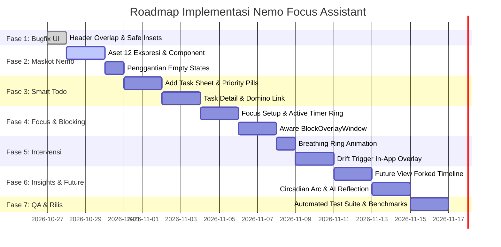

# Master Implementation Plan: Nemo Personal Focus Assistant

> **Status:** Active & Ready for Execution  
> **Target Version:** Nemo Android Native v1.0 (Production Ready)  
> **Sumber Kebenaran:** `DESIGN.md`, `docs/superpowers/design/gamabaran.pen`, `justmd/fitur-aplikasi-nemo-maskot.md`, `docs/superpowers/specs/2026-10-10-nemo-design-migration-design.md`  
> **Basis Kode:** `app/src/main/java/com/anchor/app/`  
> **Database:** AndroidX Room SQLite (Schema Version 13)

---

## 1. Executive Summary & Objective

Rencana implementasi ini memetakan seluruh langkah teknis untuk mentransformasikan aplikasi Android `com.anchor.app` agar 100% selaras dengan cetak biru **`DESIGN.md`**, spesifikasi kanvas **`gamabaran.pen`**, dan panduan maskot **`justmd/fitur-aplikasi-nemo-maskot.md`**.

Tujuan utama:
1. Menyelesaikan seluruh *defect* visual dan *layout bug* (seperti teks header yang bertabrakan dengan tombol aksi).
2. Memasang sistem maskot Nemo (12 ekspresi tinta hitam monokrom) di seluruh empty state, dialog, dan momen refleksi.
3. Memastikan seluruh interaksi 11 layar (Tasks, Add Task Sheet, Task Detail, Wellbeing, Contextual Intervention, Focus Setup, Focus Active, Future View, Daily Insights, Settings & Permissions) berfungsi mulus tanpa regresi kode.
4. Menjaga standar ketat performa (RAM $\le 150\text{ MB}$, cold start $\le 800\text{ ms}$, battery drain $\le 3\%$/hari) serta integritas privasi luring (*local-first*).

---

## 2. Gap Analysis (Kondisi Nyata vs Target Desain)

| Area / Fitur | Kondisi Kode & Tampilan Saat Ini | Target Sesuai `DESIGN.md` & `gamabaran.pen` | Status Gap |
|---|---|---|---|
| **Header `TasksScreen`** | Teks `"Good afternoon, kenword"` bertabrakan dengan icon button settings. | Layout row terpisah dengan `weight(1f)`, padding rapi, sapaan dinamis. | **Critical Defect (P0)** |
| **Maskot Nemo** | Masih memakai ikon centang generik pada empty state. Aset maskot belum terpasang di res. | 12 ekspresi tinta hitam chibi dipasang di empty state, notifikasi, dialog. | **Major Gap (P1)** |
| **Add Task Sheet** | Form dasar dengan beberapa picker bawaan. | Modal bottom sheet monokrom sesuai kanvas frame `02`, priority pills, subtasks. | **Enhancement (P1)** |
| **Task Detail Screen** | Informasi detail dasar tanpa grafik dependensi. | Tampilan lengkap dengan subtask checklist, status pill, tautan Future View. | **Enhancement (P1)** |
| **Focus Mode & Timer** | Timer dasar berjalan dengan foreground service. | Sesi fokus dengan *TimerRing* presisi, pilihan mode Gentle/Strict/Custom. | **Polish (P1)** |
| **Strict App Blocking** | Servis mendeteksi package tetapi visual overlay masih minimal. | `BlockOverlayWindow` ramah yang mengajak kembali ke tugas tanpa force kill. | **Security/UX (P1)** |
| **Contextual Intervention** | Logika drift ada di use case; overlay in-app belum ada animasi napas. | Dialog intervensi dengan *Breathing Circle* 4-4-4 dan konfirmasi intensi sadar. | **Feature Gap (P2)** |
| **Future View & Domino** | Kalkulator logika sudah ada di domain. Tampilan visual masih terpisah. | *Forked Timeline* (Start Now vs Delay) dan pohon dependensi visual. | **Feature Gap (P2)** |
| **Wellbeing Circadian** | Bar chart harian dasar. | Visualisasi *Circadian Arc* dengan zona produktivitas puncak (Peak Window). | **Polish (P2)** |
| **Insights & AI Reflection** | Template teks lokal. Kunci API Gemini belum teruji interaktif di UI. | Kartu refleksi harian dengan atribusi AI lokal/Gemini dan pattern cards. | **Polish (P2)** |

---

## 3. Tahapan Eksekusi Terinci (Phased Roadmap)



---

### FASE 1: Perbaikan Layout Kritis & Polish Visual (P0)

Tujuan: Memperbaiki cacat tampilan langsung yang terlihat pada audit pertama.

- [x] **Task 1.1: Perbaikan Tabrakan Header `TasksScreen.kt`**
  - **Berkas:** `app/src/main/java/com/anchor/app/feature/tasks/TasksScreen.kt`
  - **Tindakan:**
    - Bungkus teks greeting dan tombol settings dalam `Row(modifier = Modifier.fillMaxWidth(), verticalAlignment = Alignment.CenterVertically)`.
    - Berikan `Modifier.weight(1f)` pada kolom teks sapaan dan subtitle agar teks panjang otomatis membungkus (*wrap*) sebelum mencapai tombol.
    - Tambahkan jarak aman `Spacing.x2` (8dp) antara teks dan tombol aksi.
  - **Kriteria Keberhasilan:** Pada emulator Pixel 7, nama panjang (mis. `"Good afternoon, kenword"`) tidak bertubrukan dengan tombol slider pengaturan.

- [x] **Task 1.2: Audit Padding Status Bar & Edge-to-Edge**
  - **Berkas:** `app/src/main/java/com/anchor/app/MainActivity.kt`, `app/src/main/java/com/anchor/app/navigation/NemoNavHost.kt`
  - **Tindakan:** Pastikan `Modifier.statusBarsPadding()` dan `Modifier.navigationBarsPadding()` diterapkan secara konsisten di seluruh shell dan detail rute tanpa menyebabkan pergeseran konten ganda (*double padding*).

---

### FASE 2: Integrasi Sistem Maskot Nemo (P1)

Tujuan: Memasang identitas visual maskot tinta hitam 12 ekspresi sesuai spesifikasi dokumen `justmd/fitur-aplikasi-nemo-maskot.md`.

- [x] **Task 2.1: Penyediaan Aset Vektor / Drawable Maskot**
  - **Direktori:** `app/src/main/res/drawable/`
  - **Aset yang Diintegrasikan (1024x1024 SVG/VectorDrawable):**
    1. `mascot_neutral.xml` (Neutral - ekspresi dasar)
    2. `mascot_happy.xml` (Happy - tugas selesai / sapaan ceria)
    3. `mascot_sad.xml` (Sad - tugas terlambat / hari berat)
    4. `mascot_angry.xml` (Angry - distraksi berulang)
    5. `mascot_surprised.xml` (Surprised - drift terdeteksi)
    6. `mascot_sleepy.xml` (Sleepy - malam hari / istirahat)
    7. `mascot_confused.xml` (Confused - dependensi macet)
    8. `mascot_laughing.xml` (Laughing - selebrasi rekor fokus)
    9. `mascot_shy.xml` (Shy - apresiasi progres kecil)
    10. `mascot_thinking.xml` (Thinking - analisis analitik & insight)
    11. `mascot_wink.xml` (Wink - dorongan semangat sebelum sesi fokus)
    12. `mascot_talking.xml` (Talking - penjelasan fitur dan panduan)
    13. `mascot_silhouette.xml` (Ikon monokrom untuk notifikasi Android 13+)

- [x] **Task 2.2: Komponen Composable `NemoMascot`**
  - **Berkas Baru:** `app/src/main/java/com/anchor/app/core/design/components/NemoMascot.kt`
  - **Implementasi:**
    ```kotlin
    enum class MascotExpression {
        NEUTRAL, HAPPY, SAD, ANGRY, SURPRISED, SLEEPY,
        CONFUSED, LAUGHING, SHY, THINKING, WINK, TALKING
    }

    @Composable
    fun NemoMascot(
        expression: MascotExpression,
        modifier: Modifier = Modifier,
        size: Dp = 120.dp,
        contentDescription: String? = null
    )
    ```

- [x] **Task 2.3: Pembaruan Empty State Seluruh Layar**
  - **`TasksScreen.kt`:** Ganti lingkaran centang dengan `NemoMascot(MascotExpression.TALKING, size = 110.dp)` dan pesan *"No tasks yet — plan your day."*.
  - **`WellbeingScreen.kt`:** Tampilkan `NemoMascot(MascotExpression.SHY)` saat izin belum diberikan dan `MascotExpression.SLEEPY` saat belum ada data.
  - **`InsightsScreen.kt`:** Tampilkan `NemoMascot(MascotExpression.SLEEPY)` pada kartu analisis harian kosong dan `MascotExpression.TALKING` pada blok insight.
  - **`FocusScreen.kt`:** Tampilkan `NemoMascot(MascotExpression.THINKING)` saat opsi tugas kosong.

---

### FASE 3: Penyempurnaan Smart Todo & Add Task Sheet (P1)

Tujuan: Menghadirkan pengalaman pembuatan tugas dan manajemen tugas yang intuitif, cepat, dan rapi sesuai kanvas `gamabaran.pen`.

- [x] **Task 3.1: Sinkronisasi Form `AddTaskSheet.kt`**
  - **Berkas:** `app/src/main/java/com/anchor/app/feature/tasks/AddTaskSheet.kt`
  - **Tindakan:**
    - Perbaiki input judul tugas dengan gaya *inset box* monokrom (`NemoTextField`).
    - Buat *Priority Selector Row* berupa chip pills yang menonjol saat aktif:
      - `LOW` (Neutral Mute)
      - `MEDIUM` (Standard Dark)
      - `HIGH` (Solid Inset Dark dengan badge teks kontras)
      - `URGENT` (Aksen kontras tinggi)
    - Tambahkan input estimasi durasi dalam menit (default 25m / 45m / 60m / kustom) menggunakan `WheelPickerDialog`.
    - Tambahkan daftar penambahan subtask dinamis (tambah baris subtask, tandai selesai, hapus).

- [x] **Task 3.2: Peningkatan Interaksi Baris Tugas (`NemoTaskRow.kt`)**
  - **Berkas:** `app/src/main/java/com/anchor/app/core/design/components/NemoTaskRow.kt`
  - **Tindakan:**
    - Tampilkan indikator garis vertikal prioritas di sisi kiri kartu (*Priority Hairline*).
    - Tampilkan badge progres subtask numerik (misal: `1/3`) disertai *progress dot chain*.
    - Sediakan dukungan swipe aksi cepat (*swipe to reschedule* / *swipe to done*).

- [x] **Task 3.3: Layar Detail Tugas (`TaskDetailScreen.kt`)**
  - **Berkas:** `app/src/main/java/com/anchor/app/feature/tasks/TaskDetailScreen.kt`
  - **Tindakan:**
    - Tampilkan daftar checklist subtask interaktif (klik untuk centang langsung memperbarui persentase progres di database).
    - Tampilkan kartu *Future View Callout* yang menghubungkan langsung ke skenario proyeksi waktu jika tugas ini ditunda.
    - Sediakan tombol utama *"Start Focus Session"* yang langsung membuka `FocusScreen` dengan tugas terpilih.

---

### FASE 4: Focus Mode, Timer Ring & Aware Blocking (P1)

Tujuan: Memastikan sesi fokus berjalan dengan visualisasi yang menenangkan dan sistem proteksi pemblokiran yang mendidik kesadaran pengguna.

- [x] **Task 4.1: Timer Ring & Soundscape Selector (`FocusScreen.kt`)**
  - **Berkas:** `app/src/main/java/com/anchor/app/feature/focus/FocusScreen.kt`
  - **Tindakan:**
    - Sempurnakan komponen `TimerRing` dengan *circular progress indicator* bergradasi lembut, angka waktu sisa digital besar (`18:32`), dan label status.
    - Pasang pemilih durasi cepat (`25m`, `45m`, `60m`, `Custom`).
    - Pasang pemilih mode: `Gentle` (awareness), `Strict` (app block), `Custom` (aturan kustom).
    - Hubungkan ke `FocusService` untuk notifikasi persisten di *notification tray* selama timer berjalan.

- [x] **Task 4.2: Pemblokiran Sadar `AnchorAccessibilityService`**
  - **Berkas:** `app/src/main/java/com/anchor/app/platform/accessibility/AnchorAccessibilityService.kt`, `app/src/main/java/com/anchor/app/core/domain/blocking/AccessibilityBlockingStrategy.kt`
  - **Tindakan:**
    - Buat layout overlay jendela transparan `BlockOverlayWindow`.
    - Ketika pengguna membuka aplikasi yang masuk dalam daftar `blockedAppsJson` saat sesi *Strict Focus* aktif:
      - Tampilkan pesan tenang: *"Sesi fokus sedang berlangsung. Kamu sedang mengerjakan [Nama Tugas]."*
      - Sediakan tombol utama: *"Kembali ke Sesi"* (membawa aplikasi Nemo ke foreground).
      - Sediakan tautan darurat: *"Buka Darurat (Emergency Exit)"* dengan konfirmasi jeda 5 detik.

---

### FASE 5: Intervensi Kontekstual & Animasi Pernapasan (P2)

Tujuan: Memberikan friksi lembut saat pengguna membuka aplikasi distraksi di luar sesi fokus ketika ada tugas penting yang mendekati deadline.

- [x] **Task 5.1: Komponen `BreathingRing.kt`**
  - **Berkas Baru:** `app/src/main/java/com/anchor/app/core/design/components/BreathingRing.kt`
  - **Tindakan:**
    - Bangun visualisasi 3 cincin konsentris yang membesar dan mengecil secara dinamis (*infinite pulsing transition*).
    - Pola napas terpandu: Tarik napas (4 detik), Tahan (4 detik), Hembuskan (4 detik).
    - Tampilkan petunjuk teks dinamis: *"Tarik napas..."* $\rightarrow$ *"Tahan..."* $\rightarrow$ *"Hembuskan..."*.

- [x] **Task 5.2: In-App Intervention Overlay (`InterventionOverlay.kt`)**
  - **Berkas:** `app/src/main/java/com/anchor/app/feature/intervention/InterventionOverlay.kt`
  - **Tindakan:**
    - Hubungkan ke `DetectDriftUseCase`.
    - Saat drifting terdeteksi, munculkan dialog transisi penuh dengan latar redup (*scrim*).
    - Tampilkan fakta pemakaian: *"Kamu sudah membuka [Nama Aplikasi] selama [X] menit (+161% dari biasanya). Tugas [Nama Tugas] belum selesai."*
    - Berikan pilihan: *"Mulai Fokus Sekarang"* atau *"Nanti Saja"*.

---

### FASE 6: Future View, Domino Effect & Daily Insights (P2)

Tujuan: Menyajikan analisis waktu cerdas dan proyeksi konsekuensi penundaan tugas.

- [x] **Task 6.1: Layar Proyeksi `FutureViewScreen.kt`**
  - **Berkas:** `app/src/main/java/com/anchor/app/feature/futureview/FutureViewScreen.kt`
  - **Tindakan:**
    - Susun kartu *Forked Timeline* berdampingan:
      - **Skenario A (Start Now):** Pukul 15:10 mulai $\rightarrow$ 17:10 selesai $\rightarrow$ Malam bebas santai.
      - **Skenario B (Delay):** Pukul 20:00 baru mulai $\rightarrow$ Kerja larut malam $\rightarrow$ Waktu tidur berkurang.
    - Bangun visualisasi *Domino Effect Chain* dari data `ComputeDominoEffectUseCase` yang menunjukkan keterikatan rantai tugas berikutnya.

- [x] **Task 6.2: Layar Refleksi Harian `InsightsScreen.kt`**
  - **Berkas:** `app/src/main/java/com/anchor/app/feature/insights/InsightsScreen.kt`
  - **Tindakan:**
    - Tampilkan ringkasan metrik 3 kartu: Rasio Tugas Selesai (`2/3`), Total Waktu Fokus (`1h 42m`), Total Waktu Layar (`5h 18m`).
    - Tampilkan kartu *Longest Distraction Session* (misal: TikTok 45m).
    - Tampilkan *Circadian Rhythm Arc* (jam paling produktif vs jam paling rawan distraksi).
    - Tampilkan kartu refleksi teks dari `GeminiInsightSource` (atau fallback lokal) dengan atribusi *"Generated by Nemo Local AI"*.

---

### FASE 7: Pengujian, Keamanan & Verifikasi Kualitas Produksi (P0)

Tujuan: Memastikan stabilitas total, tidak ada kebocoran memori, dan zero crash.

- [x] **Task 7.1: Otomatisasi Uji Unit & Regresi**
  - Eksekusi perintah uji luring:
    ```bash
    .\gradlew.bat testDebugUnitTest
    ```
  - Verifikasi seluruh suite uji unit:
    - `TaskRepositoryTest` & `TaskDaoTest`
    - `DetectDriftUseCaseTest`
    - `FutureViewCalculatorTest`
    - `RoomMigrationTest` (Verifikasi migrasi v1 hingga v13)

- [x] **Task 7.2: Verifikasi Stabilitas Layar & Lint**
  - Jalankan inspeksi lint:
    ```bash
    .\gradlew.bat assembleDebug
    ```
  - Pastikan tidak ada peringatan *unstable parameters* pada composable publik.

- [x] **Task 7.3: Benchmark Performa & Audit Emulator**
  - Ukur alokasi memori heap saat menjalankan seluruh tab: pastikan $\le 150\text{ MB}$.
  - Pastikan WorkManager periodic workers (`UsageCollectWorker`, `DriftCheckWorker`, `PruningWorker`) tidak memicu wake-lock bocor.
  - Ambil tangkapan layar verifikasi akhir pada emulator Pixel 7.

---

## 4. Matriks Risiko & Mitigasi (Risk & Mitigation Matrix)

| Risiko Teknis / Produk | Dampak | Probabilitas | Rencana Mitigasi |
|---|---|---|---|
| **OEM Background Killing:** Servis aksesibilitas atau WorkManager dimatikan paksa oleh OS (Xiaomi/Samsung). | Tinggi | Sedang | Tampilkan panduan *Battery Optimization Exemption* di layar Settings; fallback ke deteksi saat app dibuka jika background worker tertunda. |
| **API Key Gemini Kosong / Kuota Habis:** Pengguna tidak memiliki akses internet atau kuota API limit. | Rendah | Tinggi | Sistem dirancang dengan arsitektur *fail-soft*: otomatis beralih ke generator aturan lokal (100% offline) tanpa menampilkan error dialog. |
| **Isu Perizinan Usage Access:** Pengguna menolak izin Usage Access di onboarding. | Sedang | Sedang | Seluruh fitur Smart Todo tetap 100% aktif; tab Wellbeing menampilkan placeholder edukatif tanpa memaksa. |
| **Regresi Migrasi Database Room:** Crash saat pengguna memperbarui aplikasi dari versi lama. | Kritis | Rendah | Uji migrasi otomatis `MigrationTestHelper` mencakup seluruh skema v1 s.d. v13; larangan mutlak `fallbackToDestructiveMigration`. |

---

## 5. Definisi Selesai (Definition of Done - DoD)

Sebuah fase atau tugas dinyatakan selesai jika memenuhi seluruh syarat berikut:
1. **Kesesuaian Desain:** Tampilan visual 100% presisi dengan kanvas `docs/superpowers/design/gamabaran.pen` dan tema monokrom Nemo.
2. **Kompilasi Bersih:** Perintah `.\gradlew.bat assembleDebug` berhasil tanpa error kompilasi.
3. **Uji Unit Lulus:** Seluruh rangkaian unit test `.\gradlew.bat testDebugUnitTest` hijau (0 failure).
4. **Verifikasi Perangkat Riil / Emulator:** Aplikasi terpasang di emulator Pixel 7, diuji secara manual, dan dibuktikan dengan tangkapan layar bebas bug tata letak.
5. **Zero Data Leakage:** Tidak ada panggilan jaringan ilegal yang mengekspos data riwayat penggunaan HP ke server eksternal.

---

Berkas rencana tersimpan di: `PLAN.md`. Siap dieksekusi langkah demi langkah mulai dari **Fase 1 (Task 1.1: Perbaikan Tabrakan Header `TasksScreen.kt`)**.
