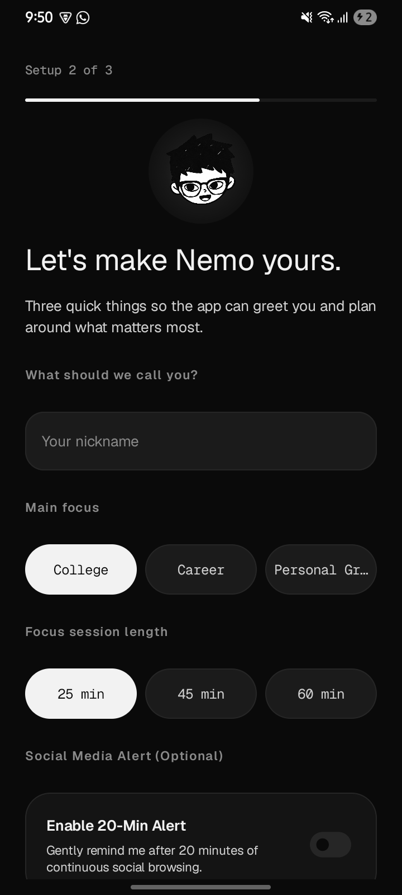
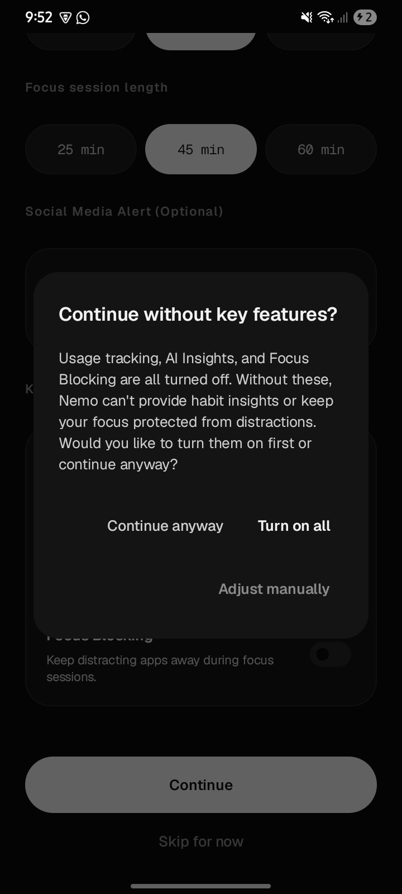
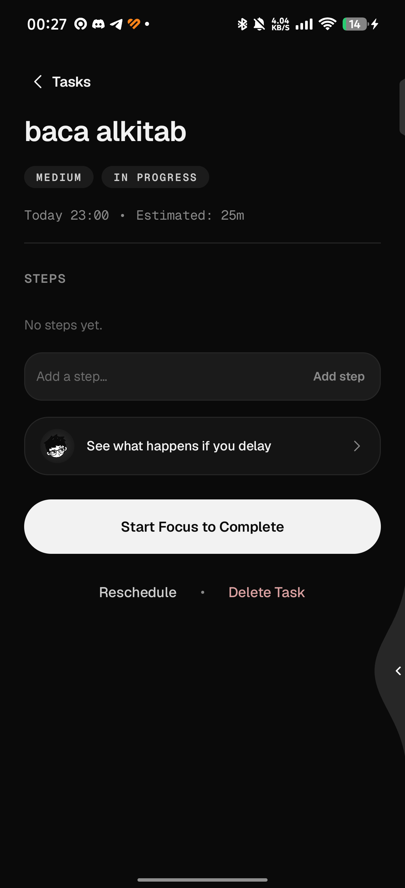
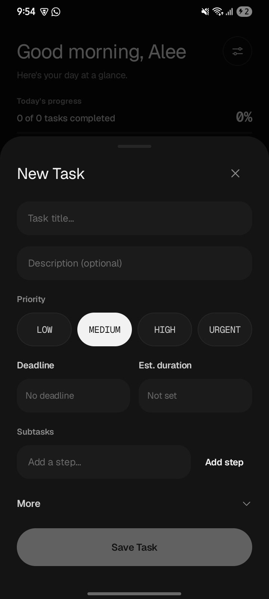
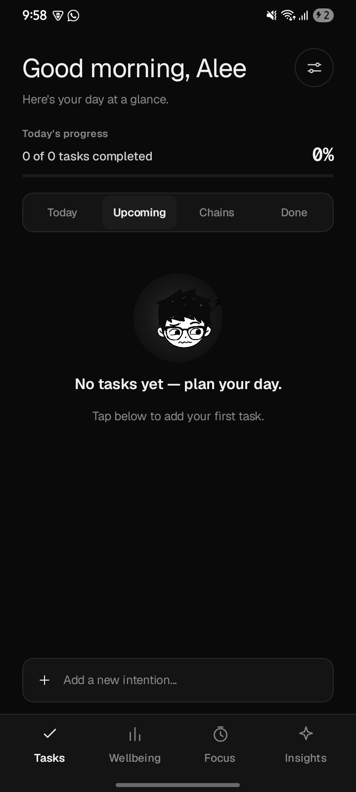
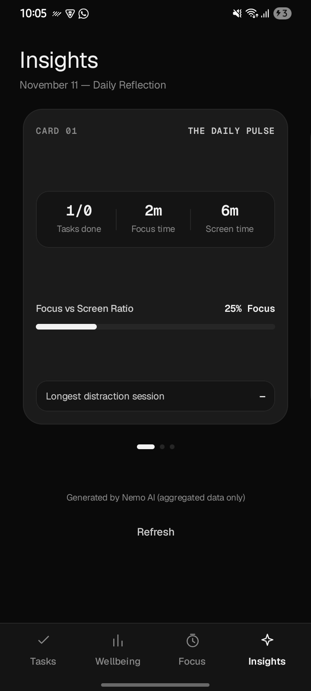
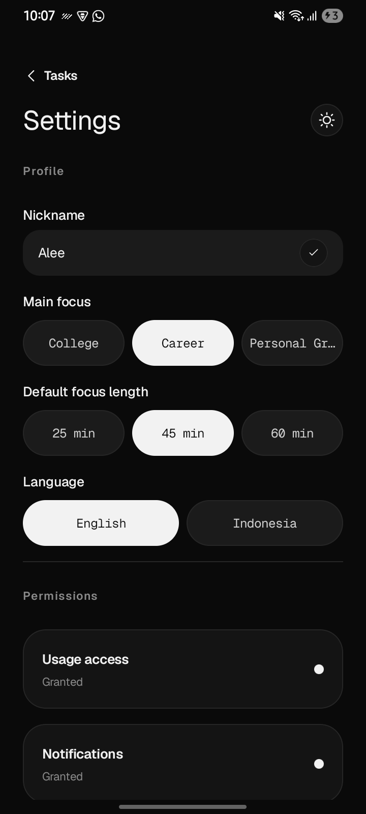

<p align="center">
  
</p>

<h1 align="center">🐟 Nemo — Personal Focus & Smart Todo Assistant</h1>

<p align="center">
  <b>Asisten fokus personal yang paham kalau kamu manusia biasa — bukan robot.</b><br />
  Menjembatani niat baik dengan aksi nyata melalui friksi lembut, visualisasi konsekuensi waktu, musik ambient lofi, dan maskot chibi yang ekspresif.
</p>

<p align="center">
  <a href="https://kotlinlang.org/"></a>
  <a href="https://developer.android.com/jetpack/compose"></a>
  <a href="https://developer.android.com/training/data-storage/room"></a>
  <a href="https://ai.google.dev/"></a>
  
  
  
</p>

<p align="center">
  <a href="#-kenapa-nemo">Kenapa Nemo?</a> •
  <a href="#-tampilan--demo-aplikasi">Galeri & Demo</a> •
  <a href="#-fitur-fitur-unggulan">Fitur Unggulan</a> •
  <a href="#-sistem-maskot-chibi-12-ekspresi">Sistem Maskot</a> •
  <a href="#-arsitektur--teknologi">Arsitektur</a> •
  <a href="#-cara-menjalankan-proyek">Cara Menjalankan</a> •
  <a href="#-komitmen-privasi">Privasi</a>
</p>

---

## 💡 Kenapa Nemo?

Pernah gak kamu bikin *to-do list* rapi di pagi hari, tapi pas siang malah tenggelam dalam *doomscrolling* media sosial selama berjam-jam? Begitu sadar, hari udah sore dan kerjaan belum ada yang kelar.

Aplikasi pemblokir biasa (*traditional app blockers*) sering kali terlalu agresif: langsung melempar kamu keluar ke layar beranda (*force home*) atau mengunci HP total. Hasilnya? Kita malah kesal (*psychological reactance*), lalu izin aksesibilitasnya dimatikan, atau aplikasinya di-*uninstall* dalam kurun waktu 3 hari.

**Nemo hadir dengan filosofi yang berbeda:**

* 🧘 **Awareness over Control** — Nemo menyadarkan, bukan mengekang. Setiap ada intervensi, kamu selalu punya kendali penuh (*"It's your call"*).
* 🍃 **Contextual Soft Friction** — Memberikan jeda bernapas dan pengingat lembut sebelum kamu membuka aplikasi distraksi.
* ⏳ **Future View & The Domino Effect** — Memperlihatkan proyeksi nyata: apa yang terjadi pada jadwal malammu kalau tugas penting ini kamu tunda sekarang.
* 🔒 **100% Local-First & Zero Telemetry** — Catatan penggunaan HP, riwayat tugas, dan sesi fokus tersimpan murni di perangkat kamu via Room DB. Data pribadimu gak pernah dikirim ke server mana pun.

---

## 🎬 Tampilan & Demo Aplikasi

Berikut sekilas pengalaman visual Nemo yang tenang dan monokromatis:

### 🎥 Video Intro & Animasi Splash Chill
Animasi splash screen bertransisi tenang dengan efek iris ekspansif, membawa nuansa lofi sebelum masuk ke alur fokus.

<p align="center">
  <video src="docs/assets/videos/splash_chill.mp4" width="70%" controls="controls" poster="docs/assets/screenshots/splash_preview.png">
    Browser Anda tidak mendukung tag video. Silakan lihat berkas di <a href="docs/assets/videos/splash_chill.mp4">docs/assets/videos/splash_chill.mp4</a>.
  </video>
</p>

<p align="center">
  <sub>💡 <i>Pratinjau video intro / splash chill Nemo (klik video untuk memutar).</i></sub>
</p>

---

### 📱 Galeri Fitur Utama

<p align="center">
  
  
  
</p>
<p align="center">
  <sub><b>1. Onboarding Ringkas & Transparan</b>: Tanpa login akun, setup fokus personal (College / Career / Growth), dan permintaan izin jujur tanpa memaksa.</sub>
</p>

<br />

<p align="center">
  
  
  
</p>
<p align="center">
  <sub><b>2. Smart Todo & Timeline Tugas</b>: Progress harian visual, pemecahan tugas ke subtask terkecil, dan filter timeline rapi (Today, Upcoming, Overdue, Completed).</sub>
</p>

<br />

<p align="center">
  
  
  
</p>
<p align="center">
  <sub><b>3. Efek Domino, Ritme Tubuh & Sesi Fokus</b>: Proyeksi dampak penundaan tugas, pelacak screen time lokal, dan mode fokus tenang dengan ambient lofi soundscape.</sub>
</p>

<br />

<p align="center">
  
  
  
</p>
<p align="center">
  <sub><b>4. Refleksi Harian, Kontrol Data & Tema Gelap</b>: Daily reflection cerdas, pengaturan privasi granular, dan desain hitam pekat (Night Mode) yang ramah mata.</sub>
</p>

---

## ✨ Fitur-Fitur Unggulan

### 1. 📋 Smart Todo with Progress & Subtask Breakdown
* **Timeline Task Node**: Setiap tugas divisualisasikan dengan node status dan garis konektor vertikal yang elegan.
* **Non-Judgemental Overdue Handling**: Tugas kemarin yang belum selesai dirangkum dalam banner ramah dengan 3 aksi cepat: *Review & Reschedule*, *Keep for Today* (pindah tenggat ke 23:59), atau *Open* langsung ke sesi fokus.
* **Subtasks Progress Engine**: Persentase kemajuan dihitung otomatis berdasarkan step yang dicentang.
* **Prioritas Berjenjang**: Penandaan LOW, MEDIUM, HIGH, dan URGENT dengan aksen halus.

### 2. ⏳ Future View & The Domino Effect
* **Komparasi Skenario Waktu**:
  * **Skenario A ("IF I START NOW")**: Memvisualisasikan jam selesai tugas jika dimulai sekarang dan sisa waktu luang yang bisa kamu nikmati nanti malam.
  * **Skenario B ("IF I KEEP DELAYING")**: Menunjukkan bagaimana waktu istirahatmu tergerus akibat menunda-nunda.
* **Domino Effect Chain**: Menghitung rantai keterkaitan tugas (*cascading dependencies*). Satu tugas tertunda akan memperlihatkan dampaknya pada tugas-tugas berikutnya.
* **Circular Link Protection**: Sistem secara otomatis menolak tautan ketergantungan yang membentuk siklus lingkaran tak berujung.

### 3. 🛡️ Aware App Blocking & Soft Friction
* **Anchor Accessibility Service**: Mendeteksi saat aplikasi distraksi (seperti media sosial atau streaming video) dibuka saat sesi fokus sedang berjalan.
* **Calm Overlay ("Back to focus?")**: Menampilkan kartu putih minimalis di atas aplikasi distraksi: *"You asked to pause this app during a focus session. Nemo is just reminding you — the choice is yours."*
* **Emergency Exit Selalu Tersedia**: Nemo tidak pernah mengunci layar HP secara permanen. Pengguna selalu memiliki kebebasan untuk keluar darurat jika ada hal mendesak.
* **Zero Screen Reading**: Layanan aksesibilitas hanya memeriksa nama paket aplikasi terdepan untuk intervensi, **tanpa pernah membaca isi ketikan atau konten layar pengguna**.

### 4. 📊 Ritme Tubuh & Digital Wellbeing (100% Offline)
* **Real Android Screen Time**: Mengambil data penggunaan aplikasi langsung dari `UsageStatsManager` lokal.
* **Analisis Komparatif Jujur**: Menampilkan perbandingan waktu layar hari ini vs kemarin dan rata-rata mingguan (delta jam/menit dan tren persentase distraksi).
* **Weekly Bar Chart Interaktif**: Grafik batang 7 hari yang dapat diketuk untuk melihat rincian pemakaian pada hari-hari sebelumnya.
* **Deteksi Drift Berkala**: Menggunakan `WorkManager` untuk mendeteksi deviasi pemakaian aplikasi non-produktif setiap 15 menit tanpa menguras baterai perangkat.

### 5. 🎧 Built-in Ambient Lo-Fi Player
* **Soundscape Fokus Terintegrasi**: Pemutar musik lofi bawaan langsung di layar sesi fokus aktif.
* **Pilihan Genre Suasana**: Pemilih genre lofi (seperti Chill Beats, Study Flow, Deep Focus) yang dirancang untuk menjaga gelombang otak tetap tenang.
* **Animasi Waveform Audio Hidup**: Visualisasi gelombang bar audio yang bergerak dinamis saat audio dimainkan.

### 6. 🧠 Hybrid Daily Reflection (Offline Heuristics + Gemini AI)
* **Refleksi Produktivitas Harian**: Merangkum pencapaian harian, waktu fokus total, dan jam paling produktif.
* **Pendekatan Hibrida & Jujur**:
  * **Offline Heuristics**: Berjalan 100% tanpa internet menggunakan aturan cerdas berbasis riwayat lokal.
  * **Google Gemini API (Opsional)**: Jika pengguna memasukkan API key di Settings, Nemo menghasilkan refleksi naratif yang lebih mendalam dan personal.
* **Zero PII Guarantee**: Hanya ringkasan statistik agregat (misal: jumlah tugas selesai, durasi fokus) yang dikirim ke Gemini. Nama tugas spesifik, detail teks, dan data sensitif tetap berada di perangkat.

---

## 🎭 Sistem Maskot Chibi (12 Ekspresi)

Nemo ditemani oleh karakter maskot anak laki-laki chibi bergaya goresan tinta hitam (*black-marker ink style*) yang hidup dan memiliki 12 ekspresi kontekstual:

<div align="center">

| 😊 Happy | 😐 Neutral | 🗣️ Talking | 🤔 Thinking |
| :---: | :---: | :---: | :---: |
| <br /><sub>Progress 100% & Selesai Fokus</sub> | <br /><sub>Idle & Sesi Fokus Berjalan</sub> | <br /><sub>Menyapa & Onboarding</sub> | <br /><sub>Future View & Analisis Data</sub> |

| 😴 Sleepy | 😠 Angry | 😭 Sad | 😉 Wink |
| :---: | :---: | :---: | :---: |
| <br /><sub>Fokus Dipause / Belum Ada Data</sub> | <br /><sub>Buka App Terblokir / Proyeksi Delay</sub> | <br /><sub>Tugas Overdue / Sesi Batal Cepat</sub> | <br /><sub>Tips & Animasi Kedip</sub> |

| 😳 Shy | 😆 Laughing | ❓ Confused | 😲 Surprised |
| :---: | :---: | :---: | :---: |
| <br /><sub>Memohon Izin Sistem</sub> | <br /><sub>Target Mingguan Tercapai</sub> | <br /><sub>Notice Siklus / Fallback</sub> | <br /><sub>Momen Eureka</sub> |

</div>

> 🎨 **Desain Adaptif**: Pada tema terang, maskot tampil bersih langsung di atas canvas. Pada tema gelap (*#0A0A0A*), maskot dilapisi badge lingkaran kontras agar garis rambut dan kacamatanya tetap terlihat tegas dan menawan.

---

## 🏗️ Arsitektur & Teknologi

Nemo dibangun mengikuti kaidah **Clean Architecture** berlapis dan pola presentasi **MVI (Model-View-Intent)** dengan **Unidirectional Data Flow (UDF)**:

```mermaid
graph TD
    subgraph UI_Layer [Presentation Layer - Jetpack Compose & MVI]
        UI_Screens[Screens: Tasks | Wellbeing | Focus | Insights | FutureView | Settings]
        UI_Overlays[Overlays: BlockOverlayWindow | InterventionSheet]
        UI_Design[Design System: NemoTheme | NemoColors | AnimatedMascotView]
        ViewModels[MVI ViewModels: TasksViewModel | WellbeingViewModel | FocusViewModel | InsightsViewModel]
    end

    subgraph Domain_Layer [Domain Layer - Pure Kotlin Use Cases]
        TaskUseCases[Task UseCases: ObserveTasks | CreateTask | RescheduleTask]
        DriftUseCases[DetectDriftUseCase | EvaluateInterventionUseCase]
        FutureCalc[FutureViewCalculator | ComputeDominoEffectUseCase]
        FocusUseCases[StartFocusUseCase | PauseFocusUseCase | FinishFocusUseCase]
    end

    subgraph Data_Layer [Data & Persistence Layer - Room SQLite v16]
        RoomDB[(AnchorDatabase - Room Schema v16)]
        DAOs[TaskDao | SubtaskDao | UsageSessionDao | FocusDao | AppSettingsDao]
        RepoImpl[TaskRepositoryImpl | UsageRepositoryImpl | SettingsRepositoryImpl]
    end

    subgraph Platform_Layer [Android Platform Integrations]
        WorkManager[Android WorkManager: DriftCheckWorker | UsageCollectWorker]
        UsageStats[Android UsageStatsManager API]
        Accessibility[AnchorAccessibilityService: Window State & Block Overlay]
        MediaFramework[Media3 ExoPlayer: Lofi Audio & Video Splash]
    end

    UI_Screens --> ViewModels
    ViewModels --> TaskUseCases
    ViewModels --> DriftUseCases
    ViewModels --> FutureCalc
    ViewModels --> FocusUseCases
    TaskUseCases --> RepoImpl
    DriftUseCases --> RepoImpl
    RepoImpl --> DAOs
    DAOs --> RoomDB
    Platform_Layer --> RepoImpl
```

### 🛠️ Tech Stack & Library

| Komponen | Teknologi | Keterangan |
|---|---|---|
| **Bahasa Pemrograman** | Kotlin `2.0.21` | Modern, null-safe, coroutines & flows |
| **Toolkit UI** | Jetpack Compose + Material 3 | Declarative UI, dynamic theming Day/Night |
| **Dependency Injection** | Dagger Hilt `2.51.1` | Modular & decoupled architecture |
| **Penyimpanan Lokal** | AndroidX Room `2.6.1` (Schema v16) | SQLite lokal terenkripsi tipe aman dengan automated migrations |
| **Asinkron & Reaktif** | Kotlin Coroutines & StateFlow | Reactive streams & non-blocking IO |
| **Penjadwalan Latar Belakang** | AndroidX WorkManager `2.9.1` | Baterai efisien untuk drift check & sinkronisasi lokal |
| **Digital Wellbeing** | Android `UsageStatsManager` | Pelacak waktu layar lokal tanpa dependensi pihak ketiga |
| **Intervensi Aplikasi** | Android `AccessibilityService` | Monitoring jendela aktif & overlay pencegah distraksi |
| **Media & Audio** | AndroidX Media3 (ExoPlayer) | Pemutaran lofi focus soundscape & video splash screen |
| **Kecerdasan Buatan** | Google Gemini REST API (Client) | Ekstraksi wawasan refleksi harian (opsional, agregat saja) |
| **Tipografi** | Manrope, Fraunces & Geist Mono | Tipografi elegan monokromatis lisensi OFL |

---

## 🚀 Cara Menjalankan Proyek

### 1. Prasyarat Sistem
* **Java Development Kit (JDK)**: JDK 17
* **Android Studio**: Ladybug / Meerkat (atau versi terbaru yang mendukung AGP 8.7+)
* **Android SDK**: `compileSdk = 35`, `minSdk = 26` (Android 8.0 Oreo ke atas)

### 2. Kloning Repositori
```bash
git clone https://github.com/dafichristiann/nemo.git
cd nemo
```

### 3. Konfigurasi `local.properties`
Buat berkas `local.properties` di root direktori proyek jika belum ada:
```properties
sdk.dir=C\:\\Users\\<NamaUser>\\AppData\\Local\\Android\\Sdk

# Opsional: Jika ingin mencoba fitur AI Daily Reflection dengan Google Gemini
GEMINI_API_KEY=AIzaSyYourGeminiApiKeyHere
```
*(Catatan: Jika `GEMINI_API_KEY` tidak diisi, Nemo akan secara otomatis menggunakan mesin refleksi lokal berbasis heuristik offline tanpa error).*

### 4. Build & Install via CLI
```powershell
# Membangun APK varian Debug
.\gradlew.bat :app:assembleDebug

# Menjalankan seluruh Unit Test
.\gradlew.bat :app:testDebugUnitTest

# Memasang APK ke emulator / perangkat HP yang terhubung via ADB
adb install app\build\outputs\apk\debug\app-debug.apk
```

---

## 🔒 Komitmen Privasi (Privacy-First Guarantee)

Privasi bukan sekadar fitur tambahan di Nemo; ini adalah pondasi arsitektur kami:

1. **Tanpa Akun & Tanpa Login**: Kamu tidak perlu memasukkan email, nomor HP, atau membuat akun untuk menggunakan 100% fitur Nemo.
2. **Data Pemakaian Tidak Pernah Keluar**: Riwayat aplikasi apa saja yang kamu buka, berapa menit kamu scrolling, dan daftar tugas harianmu **100% tersimpan di SQLite lokal perangkat**.
3. **Tanpa Pelacak Pihak Ketiga**: Tidak ada Google Analytics, Firebase Telemetry, Facebook Pixel, atau SDK iklan yang mengintai aktivitasmu.
4. **AI Berbasis Agregat**: Jika kamu mengaktifkan fitur Gemini AI, Nemo hanya mengirimkan angka ringkasan statistik (contoh: *"Hari ini pengguna menyelesaikan 3 dari 4 tugas dan fokus 45 menit"*). Teks tugas sensitif dan riwayat mentah tidak pernah dikirimkan.
5. **Hapus Semua Data Sekali Klik**: Tersedia opsi *Delete All Data* di menu Pengaturan yang membersihkan seluruh database SQLite dan preferensi aplikasi secara instan.

---

## 🗺️ Roadmap & Status Proyek

- [x] **Fase 1: Layout Kritis & Edge-to-Edge Support** (Selesai)
- [x] **Fase 2: Sistem Maskot Nemo 12 Ekspresi & Dynamic Animated View** (Selesai)
- [x] **Fase 3: Smart Todo, Add Task Bottom Sheet & Timeline Engine** (Selesai)
- [x] **Fase 4: Focus Mode, Aware Blocking Overlay & Lofi Audio Player** (Selesai)
- [x] **Fase 5: Soft Intervensi Kontekstual & Doomscroll Alert** (Selesai)
- [x] **Fase 6: Future View, Domino Effect & Gemini AI Reflection** (Selesai)
- [x] **Fase 7: Hardening, Unit Testing, Room Schema v16 & R8 Shrinking** (Selesai)
- [ ] **Fase 8: Ekspor Cadangan Data Lokal (JSON / SQLite Backup)** (Segera)
- [ ] **Fase 9: Widget Layar Utama (Home Screen Quick Focus)** (Segera)

---

## 🤝 Kontribusi

Kontribusi selalu terbuka lebar! Baik itu perbaikan bug, penambahan fitur lofi baru, atau saran desain:

1. *Fork* repositori ini
2. Buat *branch* fitur kamu (`git checkout -b feature/FiturKeren`)
3. *Commit* perubahan kamu (`git commit -m 'feat: tambah fitur keren'`)
4. *Push* ke *branch* tersebut (`git push origin feature/FiturKeren`)
5. Buka **Pull Request** ke *branch* `dev`

---

## 📄 Lisensi

Proyek ini didistribusikan di bawah lisensi terbuka (Open Source) — bebas digunakan, dipelajari, dan dikembangkan untuk kebutuhan personal maupun riset.

---

<p align="center">
  Dibuat dengan ❤️ dan secangkir kopi untuk membantu kita semua lebih fokus dan hadir di dunia nyata.<br />
  <b>Nemo Team · 2026</b>
</p>
